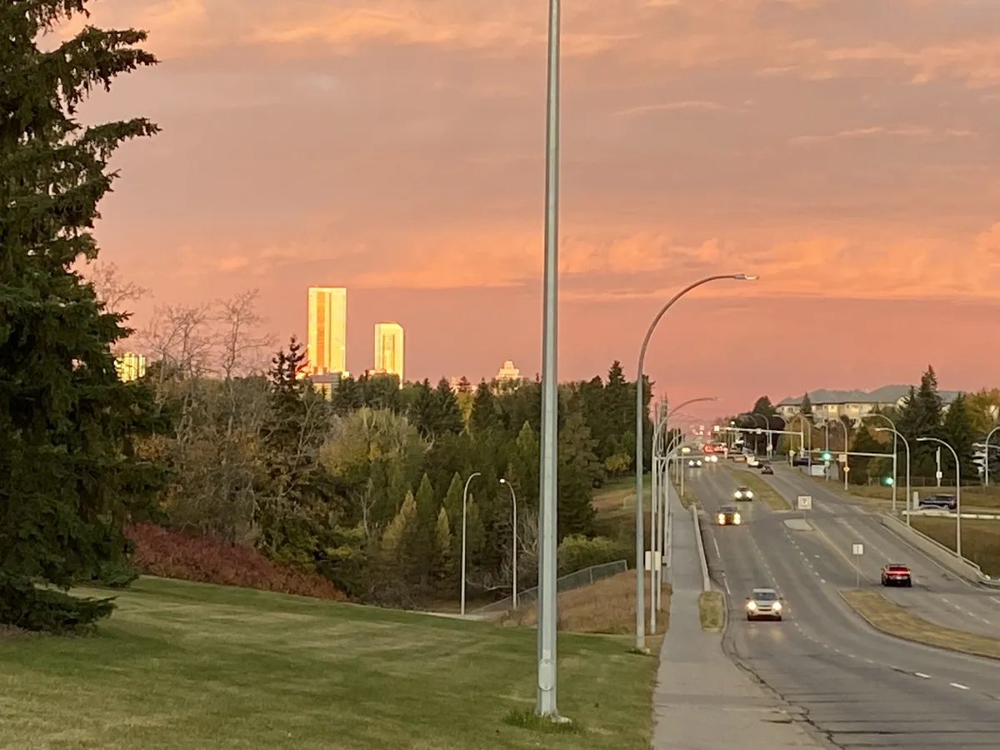

It's fall, at least in Edmonton, where the leaves have been changing and falling for a while.  I'm curious if we will get snow this year before Halloween.  I give it a 75% chance based on what I remember, but my memory is faulty and I gave up on finding actual statistics after an online search or two.

Now I feel like I need to post a picture of leaves or something.  Social media is hard for me.  I guess I'll take a real picture and not create an AI picture.  Wait, are blogs considered social media?  Well, for me they are.  Anyway, behold Edmonton on a lovely fall day.

Enough of the above.  The purpose of this post is to start a monthly update.  Let's start with last month.

### Summary of September

- We held the first Weekly Dev Chat (WDC) in-real-life (IRL) event of the 2026/2027 season, and it was trivia.  We had about 10 people in total, including 2 hosts, with some people arriving late.  Aside from having to wait for the late arrivals it was fun, or at least everyone seemed to have fun.  Shout out to [Omar](https://www.ashour.ca/), who originally ran trivia virtually and then organized the IRL version.

- The SaturdayMP Show was all 7 Billion Humans for all of September.  I'm enjoying solving the puzzles, but at the current rate it will take me until the end of the year, if not longer.  I might have to stop solving all the speed and size challenges.  That, or take a break and come back later.

  I also switched back to recording live on YouTube as I was having issues with Camtasia audio and video not syncing correctly.  With the help of Claude and some manual adjustments I was able to mostly fix the recorded videos, but it was a pain.  Not sure how long I'll continue the live recordings, but if you're interested I'm usually live around 10:00am MDT on Monday mornings.

- I assisted a non-profit client in merging two lists of volunteers into one.  Claude was very helpful with the merge.  I gave it some sample data (I didn't want real data going to Claude), and it created a script to clean up the existing data and merge the two spreadsheets.

- I experimented with YouTrack Helpdesk for SaturdayMP and a non-profit client I'm helping.  I picked YouTrack because it's free for 3 or fewer helpdesk agents and supports the features I need, the main one being an email address people can send their issues to.  So far so good.

  The other helpdesks I looked at were too expensive for the non-profit, and more than I wanted to pay for SaturdayMP.  I still use GitHub issues for the software I build.  If you find an issue with SaturdayMP or have a question, send an email to support@saturdaymp.com.  Thanks YouTrack for providing free helpdesk software, I really appreciate it.

- I was out of commission for about a week due to a cold.  The back-to-work/school cold, which I haven't gotten in a while.  I think I got it from the non-profit where my wife and I do physical on-site labour.  Lots of people were there that day.

- I switched from Google Workspace to Proton Workspace Standard.  I've had a Proton subscription for a while but was only using the VPN and Drive.  Switching was not as hard as I thought it would be, but it was still work that took a couple of days.

- Speaking of Proton, WDC now uses Proton Meet instead of Zoom.  With client work being slow this month I had time to review which services I was getting value from.  Zoom just kept getting more and more expensive for three hosts, so it got the boot.

- A proposal to add new fields to a client's existing internal Classic ASP.NET website was delayed until January.  The proposal included applying software best practices, such as adding the code to source control and upgrading dependencies.

### Goals & Plans for October

- Since the proposal in September got delayed, I have some time for client work.  If you are stuck or need some help, give me a shout at chris@saturdaymp.com.

- Reach out to contacts and post on social media that I have time to help until the end of the year.

- Remove the SaturdayMP Show blog posts.  They just clutter up this blog.  Instead I'll try to have them on the main SaturdayMP site and maybe add some search features to the existing video page.

- Add Word Games is Dumb, and other projects, to the main SaturdayMP site.  Update the site to balance projects and consulting.  Not sure what this means yet.

- Evaluate if it's worth publishing Mini-Compressor to the Windows Store.  If so, then do it.  In either case I need to decide if I should open source Mini-Compressor.  Let me know your thoughts.

  For those that don't know, Mini-Compressor is a Windows desktop app I wrote many years ago so my wife could compress pictures she wanted to email to people, back when Gmail had a 5 MB attachment limit or something like that.  I then sold it online for a couple of years, but removed it as it was not selling well and client work was taking up most of my time.

- Plan the October WDC IRL.  The current plan is to do a watch party, but that assumes the TV at the library where we hold our events is fixed.  It was broken last month.

- Reach out to my contacts and post on social media that WDC is looking for sponsorship.  If you are reading this and want to support WDC, click this [link](https://weeklydevchat.com/sponsors/) or ping me at chris@weeklydevchat.com.  Currently we are just listing sponsors on the WDC Sponsorship page, but I'm open to other ideas.

- Add automated tests to a non-profit client's application so I can make additional changes with confidence.  The application is a Classic ASP.NET application that I've wrapped in software development best practices and fixed security/critical issues in.  I want the tests so I can update its dependencies and do non-security/critical updates.

  This follows my steps when inheriting a legacy application:

  1. Wrap it in software development best practices (source control, automated builds/releases, bug tracking, etc.).
  2. Fix security and other critical issues.
  3. Add system-level automated tests.
  4. Start dealing with non-security/critical issues and enhancements.  Add unit tests and continue incorporating best practices.

That's enough for now.  I don't want to overbook myself, especially since I wrote the first draft of this at the beginning of the month but didn't publish it until now (Oct 13th).
